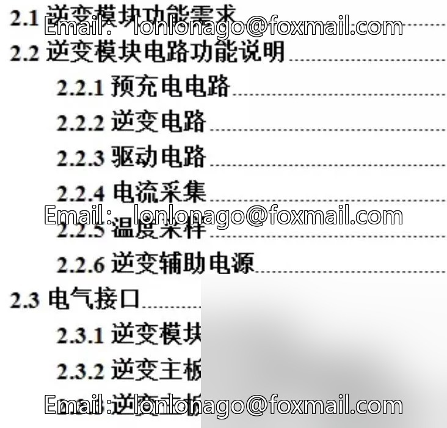

# Drive inverter module hardware design specification

## Body

Driving inverter module hardware design specification
network disk shipment, directly confirm purchase to proceed.

The manual covers driver inverter module hardware design and details functional requirements, circuit descriptions and related sections such as pre-charge, inverter, drive and current/thermal sampling.

<!-- AI_ENRICHED -->

## Images

## Payment

Here is a pay link on Stripe ( https://buy.stripe.com/3cs8yP7sY87d0vu9AB ). Please contact me lonlonago@foxmail.com after funding $89, and I will send you a complete data files , thank you!

